# Pannipe 💧

**Water delivery marketplace for Pakistan** — one Flutter app, two modes (customer + seller), Firebase-only backend.

Customers browse nearby water stores as guests, set a delivery pin on the map, add products to cart, see a distance-based delivery fee, and place COD orders. Sellers manage a store, catalogue, and order pipeline with FCM push notifications.

> **Public repo security:** Real keys live only in local `.env` / native secret files (git-ignored). See [SECURITY.md](./SECURITY.md) before every push.

---

## Table of contents

1. [Product overview](#product-overview)
2. [Tech stack](#tech-stack)
3. [Architecture](#architecture)
4. [Secrets flow (critical)](#secrets-flow-critical)
5. [User journeys](#user-journeys)
6. [Data model](#data-model)
7. [Security model](#security-model)
8. [Secrets & environment](#secrets--environment)
9. [Project layout](#project-layout)
10. [Local setup](#local-setup)
11. [Firebase console setup](#firebase-console-setup)
12. [Cloud Functions](#cloud-functions)
13. [Business rules](#business-rules)
14. [Screens & modules map](#screens--modules-map)
15. [Testing](#testing)
16. [Branching, PR & contribution](#branching-pr--contribution)
17. [Troubleshooting](#troubleshooting)
18. [Out of scope (MVP)](#out-of-scope-mvp)

---

## Product overview

| Mode | Who | Without login | Requires login |
|------|-----|---------------|----------------|
| **Customer** (default) | Anyone with the app | Browse stores, view products, set delivery location (device prefs), fill cart | Place order, open *Orders*, switch to seller |
| **Seller** | Store owner | — | Create/edit store & products, accept/reject/progress orders |

**Auth options:** Firebase **Email/Password** or **Google Sign-In**. After first login, profile asks only for **name** + **delivery mobile** (no heavy KYC).

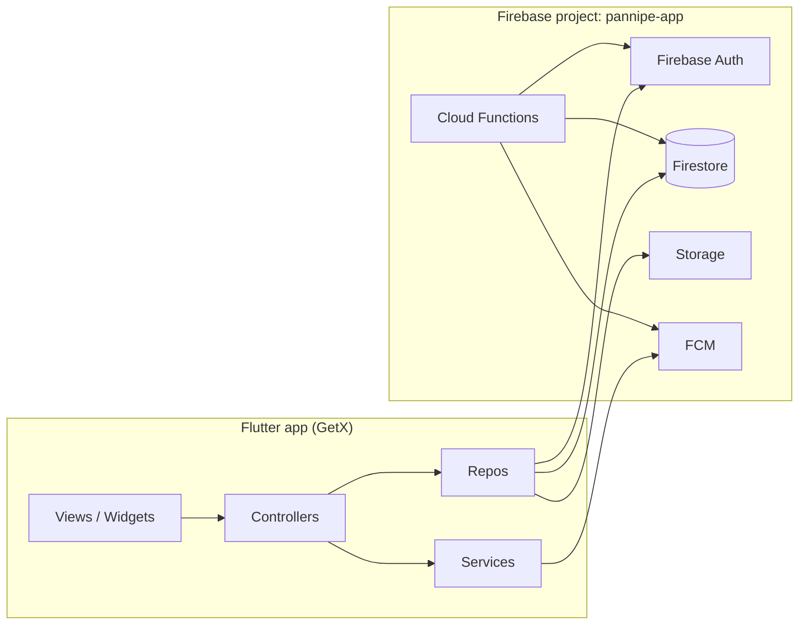

**Value proposition (MVP)**

- One binary for buyers and sellers (mode switch after login).
- Guest browsing → login only at checkout / seller actions.
- Server-side re-pricing so clients cannot underpay delivery or product totals.
- Push notifications for new orders and status changes.

---

## Tech stack

| Layer | Choice | Why |
|-------|--------|-----|
| Mobile | Flutter 3.10+ / Dart | Single codebase Android + iOS |
| State / DI | GetX | Controllers + `Get.find` DI in `get_di.dart` |
| Backend | Firebase (Auth, Firestore, Storage, FCM, Functions) | No custom Node API for MVP |
| Maps | Google Maps Flutter SDK | Delivery pin + nearby stores |
| Config | `flutter_dotenv` + `.env` | No hardcoded API keys in Dart |
| Functions | TypeScript (`functions/src`) | Order integrity + FCM (optional until Blaze) |
| Region | `asia-south1` | Pakistan / South Asia latency |

---

## Architecture

Follows `coding_principle/flutter-engineering-rules.md`:

- Screens are thin, stateless `GetView`s composed from shared widgets.
- Business logic lives in **controllers**.
- Firestore / Auth / Storage access lives in **repos**.
- Device concerns (GPS, FCM) live in **services**.
- Every dependency is registered once in `DependencyInjection` (`lib/data/helper/get_di.dart`).

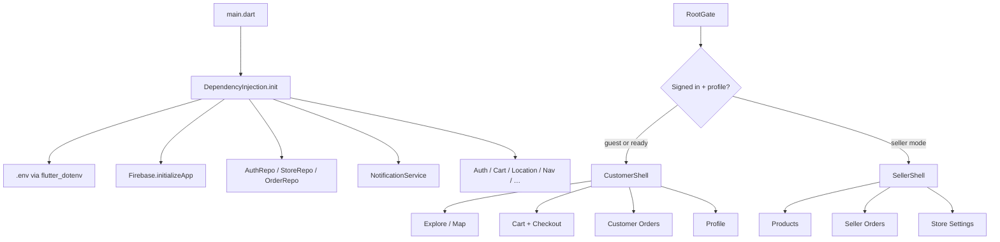

### Layering rules

| Layer | Responsibility | Example |
|-------|----------------|---------|
| `views/` | UI only — no business rules | `home_tab.dart`, checkout sheets |
| `controller/` | State, orchestration, validation UX | `AuthController`, `CheckoutController` |
| `data/repos/` | Firebase CRUD + mapping | `OrderRepo.placeOrder` |
| `data/models/` | Immutable / serializable domain types | `OrderModel`, `StoreModel` |
| `service/` | Platform APIs | `LocationService`, `NotificationService` |
| `utils/` | Pure helpers, theme, env | `delivery_fee.dart`, `Env` |

### Boot sequence

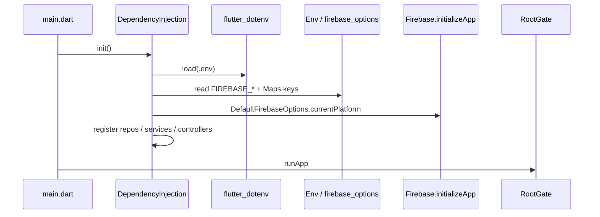

---

## Secrets flow (critical)

This is the security-critical path for a **public** GitHub repo.

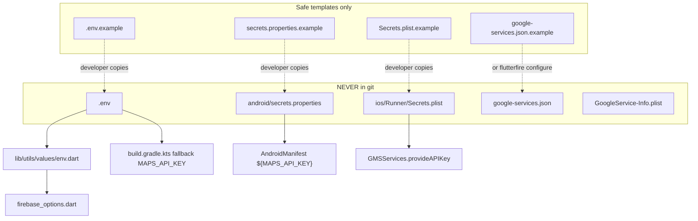

| Asset | How it stays private |
|-------|----------------------|
| API keys, Firebase client keys | Root `.env` (git-ignored); Dart via `Env` |
| Google Maps (Android) | `android/secrets.properties` → Gradle placeholders; fallback `.env` |
| Google Maps (iOS) | `ios/Runner/Secrets.plist`; `AppDelegate` at launch |
| Firebase Android config | `google-services.json` git-ignored |
| Firebase iOS config | `GoogleService-Info.plist` git-ignored |
| Keystores / PEM / service accounts | Broad gitignore patterns |
| Auth passwords | Firebase Auth only — never written to Firestore |

Committed templates: `.env.example`, `android/secrets.properties.example`, `android/app/google-services.json.example`, `ios/Runner/Secrets.plist.example`, `functions/.env.example`.

---

## User journeys

### Guest → order (customer)

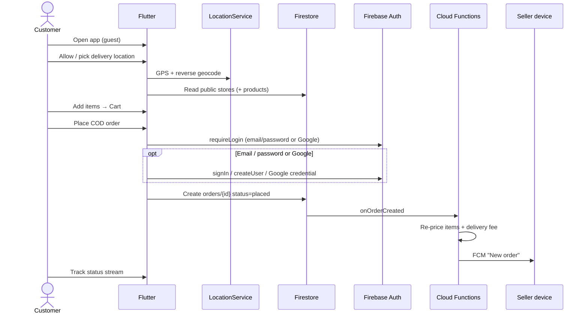

### Seller order pipeline

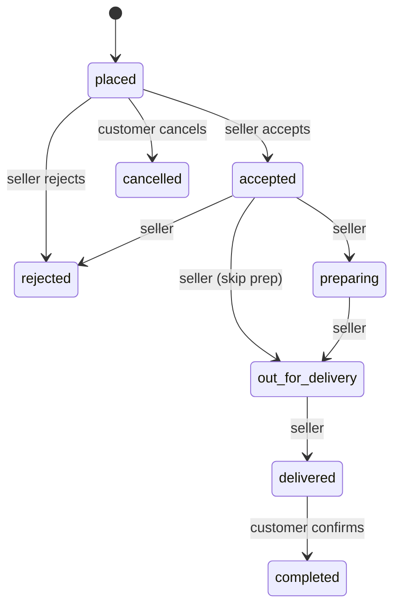

### Auth paths

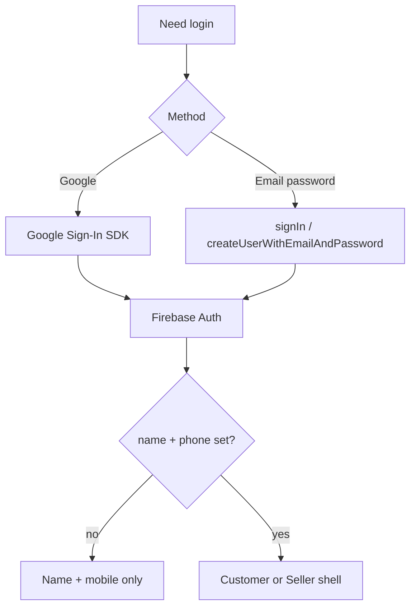

**Package / bundle ID:** `com.pannipe.app` (Android `applicationId` + iOS `PRODUCT_BUNDLE_IDENTIFIER`).

---

## Data model

| Path | Contents | Client access |
|------|----------|---------------|
| `users/{uid}` | email, name, phone, fcmTokens[] | Owner only |
| `stores/{ownerUid}` | name, phone, description, imageUrl, location, address, freeWithinKm, chargePerKm, isOpen, ownerId | Public read; owner write |
| `stores/{ownerUid}/products/{id}` | name, size, price, imageUrl, inStock | Public read; owner write |
| `orders/{id}` | customer + store snapshot, items[], subtotal, deliveryFee, distanceKm, total, paymentMethod `cod`, deliveryLocation, status, statusTimes | Customer or seller of that order |

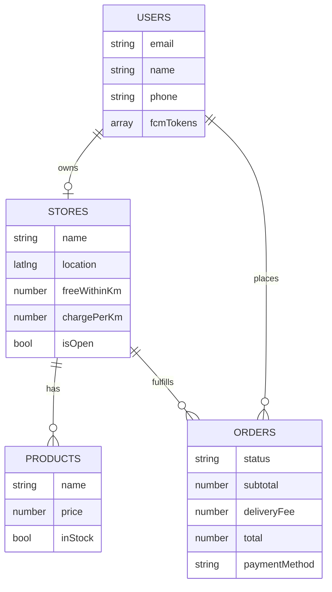

---

## Security model

Designed so a **public GitHub repo** does not leak credentials, and Firestore/Storage rules enforce least privilege.

### What is protected in Git

See [Secrets flow](#secrets-flow-critical) and [SECURITY.md](./SECURITY.md).

### Runtime trust boundaries

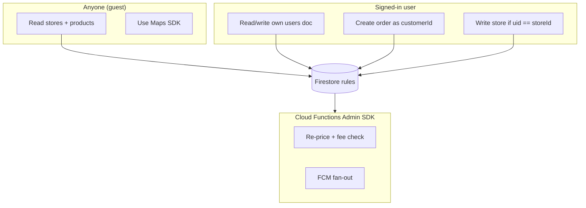

- **Firestore rules** (`firestore.rules`): public catalogue; private users; order create constrained; status transitions validated for customer vs seller.
- **Storage rules** (`storage.rules`): public image read; only store owner uploads; size capped (~5 MB).
- **Auth** is Email/Password + Google only; profile docs stay minimal (`email`, `name`, `phone`, `fcmTokens`).

> **Note:** Firebase *client* API keys are not server secrets, but we still keep them out of git and restrict them in Google Cloud (Android package + SHA-1/256, iOS bundle ID, Maps API restrictions). **Rotate any key that was ever committed historically.**

### Pre-push security checklist

```bash
git check-ignore -v .env android/secrets.properties ios/Runner/Secrets.plist android/app/google-services.json
git grep -n "AIza" -- . ':!.env.example' ':!*example*' ':!README.md' ':!SECURITY.md' || echo "OK: no raw AIza in tracked sources"
git status --ignored
```

---

## Secrets & environment

### 1. Create `.env`

```bash
cp .env.example .env
# edit .env with real values
```

Required keys for Firebase boot:

- `FIREBASE_ANDROID_API_KEY`, `FIREBASE_ANDROID_APP_ID`
- `FIREBASE_IOS_API_KEY`, `FIREBASE_IOS_APP_ID`, `FIREBASE_IOS_BUNDLE_ID`
- `FIREBASE_MESSAGING_SENDER_ID`, `FIREBASE_PROJECT_ID`, `FIREBASE_STORAGE_BUCKET`
- `GOOGLE_MAPS_API_KEY`

Optional / reserved: `BASE_URL`, `SOCKET_URL`, `YANDEX_MAPS_API_KEY`, `STRIPE_*`.

`pubspec.yaml` lists `.env` as an asset. `DependencyInjection` loads it **before** `Firebase.initializeApp`.

### 2. Sync native Maps keys

```bash
# Android
cp android/secrets.properties.example android/secrets.properties
# set MAPS_API_KEY=... (same as GOOGLE_MAPS_API_KEY)

# iOS
cp ios/Runner/Secrets.plist.example ios/Runner/Secrets.plist
# set GOOGLE_MAPS_API_KEY
```

### 3. Firebase platform files

```bash
cp android/app/google-services.json.example android/app/google-services.json
# Or prefer: flutterfire configure --project=pannipe-app
```

Then mirror Android/iOS API values into `.env` (source of truth for Dart `DefaultFirebaseOptions`).

### 4. Quick reference — where each key goes

| Secret | `.env` | Android `secrets.properties` | iOS `Secrets.plist` | Functions secrets |
|--------|:------:|:----------------------------:|:-------------------:|:-----------------:|
| `GOOGLE_MAPS_API_KEY` | ✅ | ✅ as `MAPS_API_KEY` | ✅ | — |
| `FIREBASE_*` | ✅ | via `google-services.json` | via plist | — |
| Stripe / Yandex (future) | ✅ optional | — | — | — |

---

## Project layout

```
lib/
  main.dart                       runApp only
  firebase_options.dart           reads Env (no hardcoded keys)
  data/helper/get_di.dart         dotenv → Firebase → repos → controllers
  data/constants.dart             collections, prefs keys, business constants
  data/models/                    AppUser, Store, Product, Order, …
  data/repos/<name>/              AuthRepo, StoreRepo, OrderRepo
  service/                        NotificationService, LocationService
  controller/                     Auth, Cart, Location, Explore*, Checkout, Seller, …
  utils/values/env.dart           typed access to dotenv
  utils/helpers/                  delivery_fee, validators, formatters, …
  views/widgets/                  AppButton, sheets, glass nav, map UI, …
  views/{auth,customer,seller,common}/

functions/src/
  index.ts                        onOrderCreated, onOrderUpdated
firestore.rules / storage.rules / firestore.indexes.json
coding_principle/                 engineering rules for this repo
SECURITY.md                       public-repo secret policy
```

---

## Local setup

**Prerequisites:** Flutter SDK (^3.10), Android Studio / Xcode, Firebase CLI (for Functions deploy), a Google Cloud project with Maps SDK enabled.

```bash
git clone https://github.com/codecrafteryt/paanipe.git
cd paanipe
git checkout devel

cp .env.example .env
# fill secrets…

cp android/secrets.properties.example android/secrets.properties
cp ios/Runner/Secrets.plist.example ios/Runner/Secrets.plist
cp android/app/google-services.json.example android/app/google-services.json
# replace placeholders OR run flutterfire configure

flutter pub get
flutter run
flutter test
```

Release Android builds: add the **release** keystore SHA-1/SHA-256 to the Firebase Android app, or Google Sign-In will fail.

---

## Firebase console setup

Project id used in this app: **`pannipe-app`** (override via `.env` if you fork).

1. **Firestore** — Create database (`asia-south1`). Deploy: `firebase deploy --only firestore`.
2. **Authentication** — Enable **Email/Password** and **Google**. Apps use package/bundle `com.pannipe.app`. Re-run `flutterfire configure` (or download `google-services.json`) so Android gets the OAuth web client ID Google Sign-In needs.
3. **Blaze plan** — Required for Cloud Functions (order re-price + FCM). Auth + Firestore work on Spark; Storage may need Blaze depending on bucket setup.
4. **Storage** — Same region; `firebase deploy --only storage`.
5. **Functions** (optional until you need server re-price / push)
   - `cd functions && npm install && cd .. && firebase deploy --only functions,firestore`
6. **Maps** — Enable Maps SDK for Android & iOS; restrict the key; put it in `.env` + native secret files above.

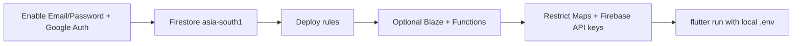

---

## Cloud Functions

| Trigger / callable | Purpose |
|--------------------|---------|
| `onOrderCreated` | Recompute subtotal from **live** product prices; recompute haversine delivery fee; correct totals; push seller |
| `onOrderUpdated` | Notify the other party on status change |
Region: **`asia-south1`**. Functions use the Admin SDK and bypass client security rules — intentional for fee integrity. Auth does **not** use Functions (Email/Password + Google are client-side Firebase Auth).

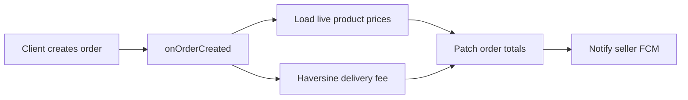

---

## Business rules

**Delivery fee** (client + server must match):

\[
\text{fee} =
\begin{cases}
0 & d \le \text{freeWithinKm} \\
\lceil (d - \text{freeWithinKm}) \times \text{chargePerKm} \rceil & \text{otherwise}
\end{cases}
\]

Distance \(d\) is straight-line (haversine), not road distance. Example: free within 3 km at Rs 20/km → 5 km order pays Rs 40.

Nearby stores are filtered on the client (≈ 25 km). Fine for hundreds of stores; add geohash queries later.

Payment MVP: **COD only**.

---

## Screens & modules map

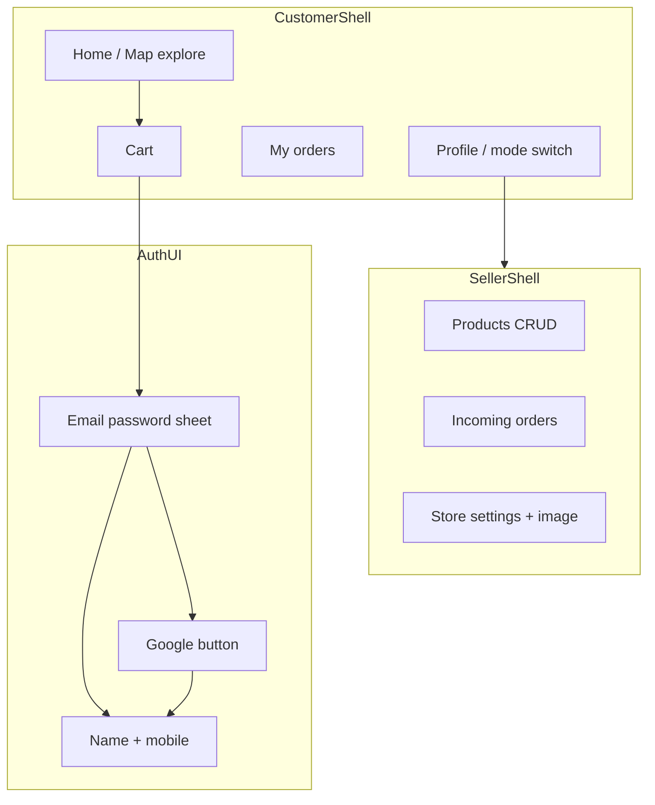

| Area | Controllers (typical) | Repos / services |
|------|----------------------|------------------|
| Auth / profile | `AuthController` | `AuthRepo`, FCM register |
| Explore / map | `ExploreController`, `LocationController` | `StoreRepo`, `LocationService` |
| Cart / checkout | `CartController`, `CheckoutController` | `OrderRepo` |
| Seller | Seller / product / store controllers | `StoreRepo`, Storage upload |

---

## Testing

```bash
flutter test
```

Includes delivery-fee math and phone/email validation coverage. Prefer adding controller/repo tests next to new features.

---

## Branching, PR & contribution

| Branch | Role |
|--------|------|
| `main` | Stable / review target |
| `devel` | Active development (default working branch) |

1. Branch from `devel` for features.
2. Open PRs into `devel` (or `devel` → `main` for releases).
3. Never commit `.env`, keystores, `google-services.json`, or `Secrets.plist`.
4. Before pushing, run the [pre-push checklist](#pre-push-security-checklist).
5. Read [SECURITY.md](./SECURITY.md).

---

## Troubleshooting

| Symptom | Likely cause | Fix |
|---------|--------------|-----|
| App crash on launch mentioning `.env` / `FIREBASE_*` | Missing or empty `.env` | Copy `.env.example` → `.env` and fill |
| Blank / gray Google Map | Missing Maps key on native side | Set `MAPS_API_KEY` / `Secrets.plist` + restrict key correctly |
| Google Sign-In fails (release) | SHA not in Firebase | Add release keystore SHA-1/256 |
| Email/password rejects | Provider not enabled / weak password | Enable Email/Password in Firebase Auth; min 6 chars |
| Google Sign-In missing OAuth client | `google-services.json` without oauth_client | Re-download config after enabling Google provider |
| Order total “jumps” after place | Expected | Functions re-price from live catalogue |

---

## Out of scope (MVP)

Separate seller / rider / admin apps, custom Node backend, wallets, subscriptions, referrals, JazzCash / EasyPaisa, road-distance routing engines.

---

## License

Private product code published publicly for collaboration — confirm licensing with the repo owner before redistribution.
